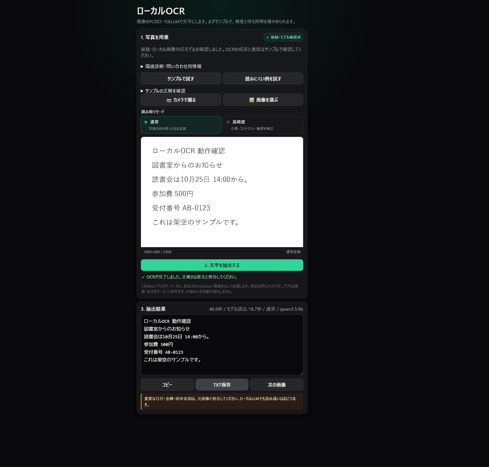

# local-ocr

画像の文字を、手元のPCで動くOllamaのビジョンモデルで読み取るWebツールです。
同じPCのブラウザで、架空のサンプル文書を使ってOCRからコピー・TXT保存まで試せます。
日本語・英数字の印刷文字を主な対象とし、写真に合わせて画像補正を選べます。



画像の変換はブラウザ内、文字の推論は設定したOllama接続先で行います。
本アプリは画像・抽出本文・履歴をサーバーのディスクへ保存しません。
ローカルOllamaを使う標準構成では、外部AI APIやAPIキーは不要です。

## 制作者の役割

今回の公開準備では、制作者が利用者のPC性能や知識の違いに配慮し、
導入から問題解決まで案内する公開方針を決め、AIへ改善を依頼しました。
その方針に沿った改善の実装・文書整備・テスト・動作確認は、AI（Codex）が行いました。

## ダウンロード前に確認

2026-10-17に、次の1台でサンプルOCRを確認しました。

| 項目 | 動作確認済みの環境 |
|---|---|
| PC | Windows x64、RAM約31.1 GiB |
| GPU | NVIDIA GeForce RTX 5060 Laptop GPU、VRAM約8 GB |
| 実行環境 | Node.js 24.21.0、Ollama 0.40.5、Chrome |
| モデル | `qwen3.5:9b`（Q4_K_M、保存サイズ約6.6 GB） |

これは最低スペックではありません。モデルの保存サイズと、推論に必要なRAM/VRAMは別です。
CPUのみ、Mac、Linux、別のGPU、軽量モデル、別PCでの本アプリのOCRは未検証です。
未検証の環境を非対応と判定したものではなく、一定の速度や精度を保証するものでもありません。
準備を始める前に、[実測条件・成功例・誤認識例](docs/VALIDATION.md) と
[Ollamaの公式対応条件への案内](docs/SETUP.md#1-実行環境を用意する) を確認してください。

## 同じPCで試す

WindowsのPowerShellを例にしています。Node.js 24以上、Ollama、Git、ブラウザが必要です。
モデルのダウンロードには通信とディスク容量が必要です。

1. [Node.js](https://nodejs.org/en/download) と [Ollama](https://ollama.com/download) をインストールし、Ollamaを起動します。
2. このリポジトリをGitHubの「Code」からcloneし、そのフォルダーでPowerShellを開きます。
3. バージョンを確認し、モデルをダウンロードします。

```powershell
node --version
ollama --version
ollama pull qwen3.5:9b
```

4. 設定ファイルを作ります。既存の `.env` があれば上書きせず、必要な項目を確認してください。

```powershell
Copy-Item .env.example .env
notepad .env
```

`.env` の `BASIC_AUTH_USER` と `BASIC_AUTH_PASSWORD` に、自分で決めたユーザー名と空でないパスワードを設定します。
`.env` はGitへコミットしません。アプリにnpm依存パッケージはなく、`npm install` は不要です。

5. 設定を読み込んで環境を診断し、サーバーを起動します。

```powershell
node --env-file=.env server.mjs doctor
node --env-file=.env server.mjs serve --port 8005
```

6. ブラウザで [http://127.0.0.1:8005](http://127.0.0.1:8005) を開き、設定した認証情報を入力します。
7. 「サンプルで試す」を押し、プレビューを見て「文字を抽出する」を押します。
8. 「サンプルの正解を確認」を開いてOCR結果と比較し、必要なら修正して「コピー」または「TXT保存」を試します。

サンプルは同梱された日本語・英数字の架空文書です。「読みにくい例を試す」で薄い文字の例も比較できます。
成功時の処理時間は、この画像・モデル・その時点のPC状態での結果です。
初回やモデルがメモリから外れた後は読み込み時間もかかります。
画面の経過時間とモデル読み込み時間を見ながら、処理中は画面を開いたまま待ってください。

詳しい導入条件、つまずいた場合の確認順、スマホ利用は [セットアップガイド](docs/SETUP.md)、
確認できた環境・OCR結果と未検証の条件は [検証記録](docs/VALIDATION.md) を参照してください。

## 自分の画像を読む

1. 「カメラで撮る」または「画像を選ぶ」で1枚選びます。
2. 「通常」または「高精度」を選び、プレビューを確認します。
3. 「文字を抽出する」を押し、結果を元画像と照合します。
4. 必要なら本文を修正してコピーまたはTXT保存します。

| モード | 処理 | 選ぶ目安 |
|---|---|---|
| 通常（既定） | 色を維持して縮小 | カラー文字、色分けされた資料、まず試すとき |
| 高精度 | 白黒化、コントラスト補正、軽い輪郭強調、小画像の拡大 | 薄い文字や低コントラストの画像で比較するとき |

「高精度」は補正方法の名前で、認識精度の向上を保証しません。
手書き、表、低照度、傾き、小さい文字は誤認識・欠落・補完が起こり得ます。
重要な日付・金額・固有名詞は元画像と照合してください。

- 1回1画像、同時OCRは1件、推論タイムアウトは既定360秒
- 元画像は20MBまで。ブラウザで開ける画像を長辺最大3,000pxのJPEGへ変換
- HEICはブラウザがデコードできる場合のみ。開けなければJPEG等へ変換
- PDF直接入力、複数画像の一括処理、履歴保存は対象外

## 動作環境の考え方

Node.js 24以上と、画像入力に対応するローカルOllamaモデルを使います。
既定モデルは `qwen3.5:9b` です。必要なメモリ・空き容量・速度はモデルと実行条件で変わり、
モデルファイルのサイズだけでは必要RAM/VRAMを判断できません。

Ollamaの対応OS・GPU条件は [Windows](https://docs.ollama.com/windows)、
[macOS](https://docs.ollama.com/macos)、[GPU](https://docs.ollama.com/gpu)、
[FAQ](https://docs.ollama.com/faq) を確認してください。
これらはOllamaの公式条件であり、本アプリのOCR完走や速度を保証するものではありません。
CPUのみ、Mac、軽量モデル、別PCでの本アプリのOCRは未検証です。
購入判断に使える最低スペックや処理時間の保証値はまだありません。

画面の環境診断または `doctor --json` で、取得できるOS・RAM・バージョン・モデル情報・
CPU/GPU配置を確認できます。取得不能な項目は未確認として扱い、診断の成功と実際のOCR成功を区別します。
GPU型番・ドライバー・空きVRAM・空きディスク容量は自動診断では未確認です。
vision対応やlocal判定を確認できないモデルは、画像の送信を止めます。

## 設定とデータの扱い

| 環境変数 | 既定値 | 用途 |
|---|---|---|
| `BASIC_AUTH_USER` | `admin` | Basic認証ユーザー名 |
| `BASIC_AUTH_PASSWORD` | なし | 必須の認証パスワード |
| `LOCAL_OCR_HOST` | `127.0.0.1` | Webサーバーの待受先 |
| `LOCAL_OCR_PORT` / `PORT` | `8005` | 待受ポート（前者を優先） |
| `LOCAL_OCR_MODEL` | `qwen3.5:9b` | OCRモデル |
| `OLLAMA_BASE_URL` | `http://127.0.0.1:11434` | Ollama接続先 |
| `LOCAL_LLM_DISPATCHER_URL` | 未設定 | 明示時のみ優先する互換ディスパッチャ接続先 |
| `LOCAL_OCR_TIMEOUT_MS` | `360000` | 推論タイムアウト（ms） |
| `LOCAL_OCR_MAX_IMAGE_BYTES` | `20971520` | デコード後画像の上限（bytes） |
| `LOCAL_OCR_MAX_REQUEST_BYTES` | `29360128` | JSONリクエストの上限（bytes） |

Nodeは `.env` を自動では読みません。上記コマンドの `--env-file=.env` を付けます。
モデルの保管はOllamaが管理します。TXT保存の保存先はブラウザを使っている端末です。
画像と本文は画面を開いている間、ブラウザのメモリにも存在します。

Basic認証は `/healthz` 以外のUI・静的ファイル・APIに必須です。
パスワード未設定の場合も保護された経路は401となります。
標準の待受先は同じPCだけです。別端末へ公開する場合はHTTPSを含む別途設定が必要です。
Basic認証自体には通信の暗号化機能がありません。

接続先を別のホストへ変更すると、その接続先へ画像とOCRプロンプトが送られます。
アプリの通常ログはモデル名・画像バイト数・処理時間・成否を記録し、画像・本文・ファイル名は記録しません。
環境診断には画像・OCR本文・認証情報・ホスト名・個人パスを含めません。
Ollama側やネットワーク側のログ・保存方針はそれぞれの設定も確認してください。

## 開発

Node.js標準機能でHTTP/API、Ollama呼び出し、テストを実装しています。

```powershell
node --test
node --env-file=.env server.mjs doctor --json
```

構成と判断理由は [DESIGN.md](DESIGN.md)、既知の課題・検証境界は [CONTEXT.md](CONTEXT.md) にあります。
